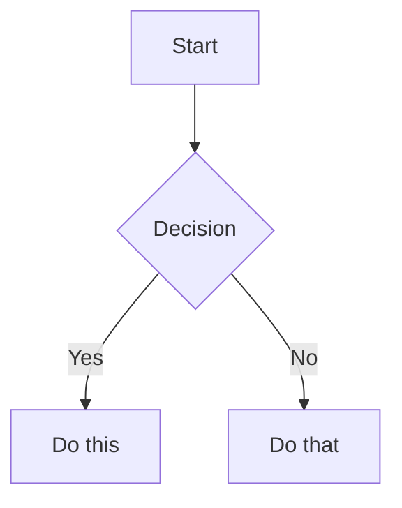

# Obsidian Flavored Markdown Skill

Create and edit valid Obsidian Flavored Markdown. Obsidian extends CommonMark and GFM with wikilinks, embeds, callouts, properties, comments, and other syntax. This skill covers only Obsidian-specific extensions -- standard Markdown (headings, bold, italic, lists, quotes, code blocks, tables) is assumed knowledge.

## Workflow: Creating an Obsidian Note


1. **Identify the note activity.** For a matching activity, read its template before drafting:
  - Architecture or concept analysis: [architecture-analysis.md](assets/architecture-analysis.md)
  - Article reading: [article-reading-template.md](assets/article-reading-template.md)
  - Daily note: [daily-note-template.md](assets/daily-note-template.md)
  - Technology learning: [tech-learning-template.md](assets/tech-learning-template.md)
  For other note types, use the structure requested by the user or the existing note; add only the headings needed for the content.
2. **Use the template as the style source.** Keep its relevant property names, heading order, and callout structure. Fill fields from the user's material, and leave an existing prompt or placeholder when the information is unavailable. Omit sections that do not apply rather than inventing details.
3. **For edits, inspect the target note first.** Preserve its established structure and wording outside the requested change. Follow the user's requested structure when it differs from the template.
4. **Load syntax references on demand.** Read [CALLOUTS.md](references/CALLOUTS.md) when adding or changing callouts, and [EMBEDS.md](references/EMBEDS.md) when adding embeds or block-linked lists.
5. **Validate the finished note.** Check frontmatter boundaries and YAML, heading and callout structure, wikilink/embed delimiters, and that each requested section is present. The note is complete when these checks pass and all supplied information is represented without unsupported claims.

## Template Style

The templates are the authority for activity-specific structure. They use YAML frontmatter, ordered descriptive headings, concise prompts, and (where appropriate) titled callouts. Preserve template emojis and callout choices when using that template; they are part of the user's note-taking style, not a global requirement for every note.

The daily-note template uses `[!call]`, a custom callout type. Preserve it for daily notes; use a documented built-in callout for other notes unless the vault's custom CSS or the user specifies otherwise.

## Internal Links (Wikilinks)

```markdown
[[Note Name]]                          Link to note
[[Note Name|Display Text]]             Custom display text
[[Note Name#Heading]]                  Link to heading
[[Note Name#^block-id]]                Link to block
[[#Heading in same note]]              Same-note heading link
```
Inside Markdown tables, escape wikilink alias pipes as `[[Note\|Alias]]` so the alias separator is not parsed as a table cell delimiter. When a table follows a paragraph, leave a blank line above it, or it renders as plain text.

Links resolve by file name, not by the `aliases` property. A bare `[[Alias]]` stays unresolved; write `[[Note|Alias]]` to show an alias.

Define a block ID by appending `^block-id` to any paragraph:

```markdown
This paragraph can be linked to. ^my-block-id
```

For lists and quotes, place the block ID on a separate line after the block:

```markdown
> A quote block

^quote-id
```

## Embeds

Prefix any wikilink with `!` to embed its content inline:

```markdown
![[Note Name]]                         Embed full note
![[Note Name#Heading]]                 Embed section
![[image.png]]                         Embed image
![[image.png|300]]                     Embed image with width
![[document.pdf#page=3]]               Embed PDF page
```

See [EMBEDS.md](references/EMBEDS.md) for audio, video, search embeds, and external images.

## Callouts

```markdown
> [!note]
> Basic callout.

> [!warning] Custom Title
> Callout with a custom title.

> [!faq]- Collapsed by default
> Foldable callout (- collapsed, + expanded).
```

Common types: `note`, `tip`, `warning`, `info`, `example`, `quote`, `bug`, `danger`, `success`, `failure`, `question`, `abstract`, `todo`.

See [CALLOUTS.md](references/CALLOUTS.md) for the full list with aliases, nesting, and custom CSS callouts.

## Properties (Frontmatter)


Properties are YAML values between opening and closing `---` lines at the start of a note. Use the selected template's property names and ordering as the schema; for example, article notes include `title`, `author`, and `read`, while daily notes include `created` and `updated`. Keep the template's blank values when information is unknown, and use valid YAML for populated values. Add properties only when they serve the note or the user requests them.

## Tags

```markdown
#tag                    Inline tag
#nested/tag             Nested tag with hierarchy
```

Tags can contain letters, numbers, underscores, hyphens, and forward slashes, but must include at least one non-numerical character (`#1984` is invalid, `#1984book` is valid). A space ends a tag, so `#my tag` is the tag `#my`. Tags can also be defined in frontmatter under the `tags` property.

## Comments

```markdown
This is visible %%but this is hidden%% text.

%%
This entire block is hidden in reading view.
%%
```


## Math (LaTeX)

```markdown
Inline: $e^{i\pi} + 1 = 0$

Block:
$$
\frac{a}{b} = c
$$
```

## Diagrams (Mermaid)

````markdown

````

To link Mermaid nodes to Obsidian notes, add `class NodeName internal-link;`.

## Footnotes

```markdown
Text with a footnote[^1].

[^1]: Footnote content.

Inline footnote.^[This is inline.]
```

## Complete Example

````markdown
---
title: Project Alpha
date: 2024-01-15
tags:
  - project
  - active
status: in-progress
---

# Project Alpha

This project aims to [[improve workflow]] using modern techniques.

> [!important] Key Deadline
> The first milestone is due on ==January 30th==.

## Tasks

- [x] Initial planning
- [ ] Development phase
  - [ ] Backend implementation
  - [ ] Frontend design

## Notes

The algorithm uses $O(n \log n)$ sorting. See [[Algorithm Notes#Sorting]] for details.

![[Architecture Diagram.png|600]]

Reviewed in [[Meeting Notes 2024-01-10#Decisions]].
````

## References

- [Obsidian Flavored Markdown](https://help.obsidian.md/obsidian-flavored-markdown)
- [Internal links](https://help.obsidian.md/links)
- [Embed files](https://help.obsidian.md/embeds)
- [Callouts](https://help.obsidian.md/callouts)
- [Properties](https://help.obsidian.md/properties)
